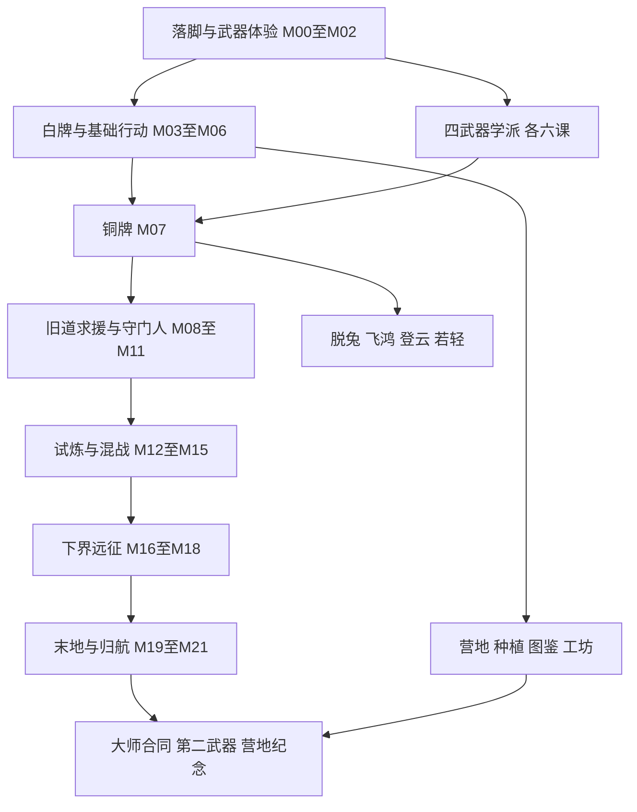

# FSRPG 冒险任务树与完整游玩方案

设计日期：2026年10月31日。基于工作区0.11.0及既有技能提案。本文是完整玩法提案，新增规则、任务、敌人、商店和动作尚未接入游戏；所有时长与数值是首轮试玩目标。现有运行配置、玩家存档和部署包不作修改。

我建议把FSRPG做成一款扎根原版生存世界的动作冒险模组：玩家从修整一个营地出发，用自己喜欢的武器打通道路、认识敌人、完成试炼，最后带着一套真正熟悉的打法回到营地。任务推进既提供明确目的，也逐步扩大玩家的选择。公会、失联驿站与边境调查是新增叙事框架；原始需求稿没有规定这套世界观。

## 设计依据和能力边界

| 来源 | 当前能据此确认的内容 | 对设计的影响 |
| --- | --- | --- |
| [README](../README.md)与[0.10.0西洋剑](rapier-fencing-0.10.0.md) | 剑五段、右键突刺与条件还击；双刀方向手位；长枪保持扫区；弓双模式 | 教学以当前操作为准，不沿用旧稿的四连和旧键位 |
| [旧版分支](旧版分支技能-0.9.0.md)与[技能树模板](../src/main/resources/defaults/skill_trees.json) | 25节点：剑4、双刀5、弓8、步法8；长枪无成长树 | 长枪需要补完整课程和树分类；现有稳定ID保留 |
| [16招提案](武器技能设计-0.8.0.md) | 四类各4招，4选2装配方案，动作和运行时仍待制作 | 作为新任务的技能奖励池，不声称当前可用 |
| [任务schema](../schemas/quests.schema.json)与[默认任务](../src/main/resources/defaults/quests.json) | KILL/COLLECT/VISIT/USE_SKILL，物品和原版经验奖励；前置须领奖 | 新认证条件、或前置、战术事件、资格奖励都要扩展 |
| [收集任务](收集任务与部署.md) | 63种生物、22种作物目录，提交与奖励交易恢复 | 保留已有收藏；主线不用稀有掉落锁进度 |
| [怪物接触](怪物攻击接触时序.md)与[相杀](近战相杀-0.8.3.md) | 受控近战接触、相杀与防御窗口；特殊法术未统一 | 选适合教学的敌人；不能把龙息、音爆都当可格挡近战 |
| [物品导入](release-0.9.3.md) | 金银晶下界币、钱袋、五色牌的物品与展示 | 兑换、钱包、公会资格和商店均是新增系统 |
| [原始DOCX需求稿](<../../performance-2026-10-05/preserved-designs/新Minecraft 1.21.1 动作战斗模组需求 (2).docx>) | 双视角、训练、配置、敌人战术、动作战斗是核心 | 等级不能取代可观察的动作和应对；不强行重做原版世界 |

本文中“现有”指上述已落地机制，“沿用提案”指16招方案，“新增”指此次设计。以下整套任务树均为新增设计。完整64节点同时保存为[设计数据](../designs/adventure-experience-2026-10-31.json)，它不是运行时quests.json，也没有声称通过运行时schema。

## 玩家的一次冒险和长期路线

一次20至40分钟的出行：在营地修理、选择最多3个追踪目标和2个主动招式；沿路线采集或调查；经历1至3场有不同战术问题的遭遇；带着材料和新理解回营地领报酬、学招、改造住所。战斗密度由路线控制，教学任务只聚焦一个新概念。回营地有实用价值，但不会每杀一只怪就要求返程。

| 阶段 | 累计时间目标 | 核心体验 | 永久奖励 |
| --- | --- | --- | --- |
| 序章 M00至M03 | 0至45分钟 | 有落脚处，免费试武器，完成第一次真实战斗 | 白牌、所选武器入门、安全训练 |
| 铜牌 M04至M07 | 45分钟至2小时 | 看懂前摇，保留体力，走通路线 | 第一主动槽、铁器升级、任务选择 |
| 银牌 M08至M11 | 2至5小时 | 处理远程压力，形成打法，首个有动作设计的精英 | 第二主动槽、工坊、银牌 |
| 钴牌 M12至M15 | 5至9小时 | 试炼、多敌、转火、撤退 | 四招选二的成型武器、钴牌 |
| 远征 M16至M20 | 9至17小时 | 下界地形、准备、末地目标处理 | 改造配方、屠龙记录、终阶资格 |
| 归来 M21 | 12至20小时 | 带着武艺返回自己的世界 | 金牌、终局、个人纪念 |
| 支线与终局 | 总计30至50小时 | 第二武器、生活、困难变体和展示 | 横向选择与外观 |

时间以普通难度的新角色为首轮试玩目标，不是现有流程测量；世界地形、搭建与熟练程度会改变时长。原版生存、建造、采掘、附魔、传送门和Boss入口始终可自行推进，公会等级只管公会服务与内容，不封锁原版玩法。高手可以提前打龙，事件先记账，之后到相应章节追认。

前60分钟安排：0至10分钟落脚与吃饭；10至20分钟试一件武器；20至35分钟看前摇和停手回架；35至50分钟出门解决一场遭遇；50至60分钟回营地看白牌并体验第二课。进入真实战斗前，提供反复练习且不损耗正式物品的场地。主线考生存判断，精确操作集中在可选武器课程；任一武器走通即可毕业。

叙事采用“重新连通驿路”。第一幕发现近郊驿站失联，玩家带回消息并打通旧道；第二幕在地下试炼找到前代冒险者留下的技术记录，用各学派的方法通过混战；第三幕将调查扩展到下界，建立新的安全路线；末地归航则把自己的路线、战斗经验与纪念留给后来者。玩家的身份是能解决问题的冒险者，终章仍回到自己经营的世界，允许继续种地、建造或只钻研一门武艺。

公会只需三个清楚的功能角色：登记员解释路线与结算，教习演示招式并允许重试，工匠负责修理、侧改和外观。初版可由营地功能台与可阅读行记承担，后续再加独立NPC、对话和表情，不让NPC寻路与大量对白阻塞动作玩法交付。玩家自建营地能承载同样服务；公会不是必须反复回访的唯一出生城。

## 任务树的结构

图表示体验关系；下表与JSON才是精确前置。前置中的分号表示全部需要，ANY表示所列任意一个；除明确临时试用外，条件只能用前置已给出的能力完成。M07要求任一学派第二课、M10要求任一第四课、M15要求任一第五课。其他武器和生活支线均不阻塞主线。图中的学派节点不是“完成全部24课”的门槛。

每节点分为可接取、进行中、已完成、奖励待领、已领奖。新主线以前置“已完成”为准，资格与认证原子登记，实体奖励进入待领账本；旧三个任务继续保留原来“领奖后开前置”的语义。M10在可接取时开放第二槽的教学权限，完成后永久化；离场未完成撤销临时权限，因此不会出现要先完成任务才能使用完成条件的死锁。

## 条件和奖励的统一解释

“真实命中”必须是服务端接受的攻击在合法接触阶段造成有效伤害；被格挡和相杀属于接触事件，不混算伤害命中。训练场可以产生明确的训练命中，不能用于野外成长、掉落和重复经济奖励。每次动作、接触段、目标UUID去重；敌人“恢复期命中”必须引用其服务端攻击序列。空挥、点按次数和客户端动画播放都不能充当实战命中。

“完成遭遇”以登记敌人和区域目标为准：单人满足胜利条件即可；多人按真实参与发个人任务奖励，怪物实体掉落只生成一次。普通任务不要求最后一刀；参与须满足造成有效伤害、防守有效攻击或完成救援目标之一，且与该场遭遇关联，旁观不计。武器课程必须本人完成指定动作；联机中的搭档不能代做精准格挡。

表中银为设计上的银币单位，1金币兑换100银币；经验为原版经验点而非等级。每个主线节点另给20经验，武器课15、步法12、生活10、终局25；不额外直接加武器成长分。技能、资格、配方与外观都只发一次。补给包=面包4；试炼补给包=面包6加火把16。重复任务的奖励见经济规则，不能重复领首通认证。

训练失败只重置当前练习目标，可马上再试，训练场恢复借用装备和资源且没有正式掉落。野外死亡沿用世界的掉落规则，已完成任务、认证和待领报酬保留；正在进行的连续遭遇目标重置。满背包保留待领，不落地丢弃奖励。所有教学有文字、音效、形状提示，金闪不单靠颜色。

## 主线任务

| ID | 任务 | 前置 | 完成条件 | 银币 | 其他奖励 |
| --- | --- | --- | --- | ---: | --- |
| M00 | 拾起行记 | 无 | 首次进入启用冒险规则的世界，打开一次行记；已有角色可从迁移入口进入 | 0 | 冒险行记入口、附近安全教学点指引；死亡可从J重开，无需保管实体书 |
| M01 | 今晚有落脚处 | M00 | 完成一次安全营地休息并实际吃完一种食物；有效睡眠也可替代营地休息 | 0 | 开启心法；教学场资格；面包3；营地休息是新增交互，不改变世界时间 |
| M02 | 先拿稳武器 | M01 | 四类训练器任选一种，完成3次有效接触、1次主动停手回架及1次安全普通防守；训练器和基础操作临时授权自动借出 | 0 | 永久认证所选武器入门；安全教学防守后开启煅体、步法；返还训练器，发所选石质武器组或弓与16箭 |
| M03 | 第一次平安归来 | M02 | 参与击败1只真实敌对生物，再回到任一安全营地；原初次狩猎完成记录可抵战斗项 | 8 | 白色冒险者资格与白牌；心法2/煅体2/步法4一次性训练奖励；开启野外委托 |
| M04 | 看见前摇 | M03 | 教学敌人的3次不同攻击中，分别完成普通格挡或离开有效攻击范围；不要求精准格挡 | 6 | 防御教学进阶；食物补给包1 |
| M05 | 留力再战 | M04 | 在同场教学遭遇中实际攻击至体力低于40%，脱离接触至回到60%，再有效命中1次；不要求耗空 | 6 | 体力与空挥反馈教程完成；食物补给包1 |
| M06 | 把路走通 | M03 | 绑定一个自建或公共营地，实地到达2个不同调查点并返回；调查点可沿途生成 | 10 | 营地登记、路线标记；火把16；开放生活支线 |
| M07 | 铜牌委托 | M05;M06;ANY:R02,D02,S02,A02 | 完成狩猎、勘路、运补中任一铜牌合同；合同分别为清理1处遭遇/调查3点/真实交付8份面包或等值食物 | 20 | 铜色资格与铜牌；主动技能槽A；升级券1，可选铁质近战武器组或全耐久弓加32箭；首轮分支重选免费 |
| M08 | 选择接敌方式 | M07 | 通过一场带远程敌人的教学遭遇：利用遮挡接近并击败射手，或远程压制并击败，或侧路抵达目标撤离区，三选一 | 12 | 敌情笔记；箭24或盾1或补给包2任选一 |
| M09 | 旧道上的求援 | M08 | 到达失联驿站，救援终端交互后处理伏击并带回信物；可清敌或开通逃生路线完成救援 | 15 | 营地间路线网络、旧道事件重访；不做长距离脆弱NPC护送 |
| M10 | 形成自己的打法 | M09;ANY:R04,D04,S04,A04 | 在营地装配两个已学主动技能并完成一次预览；没有强制施放连招窗口 | 0 | 主动技能槽B即时开放；一次免费装配教学；此任务开放后即可装备第二槽并完成条件 |
| M11 | 旧道守门人 | M10 | 击败旧道守门人；门前训练可无限重试；结果通过即可，精准格挡/无伤仅作额外评级 | 40 | 银色资格与银牌；强化工坊服务、支线精英合同；心法2/煅体2/步法4 |
| M12 | 地下的回声 | M11 | 找到1处真实试炼区域并调查入口、补给点、活动刷怪笼3类线索；缺少近邻结构可生成独立公会试炼遗址 | 20 | 试炼复盘入口；试炼补给包1；结构替代实例必须实际运行相同服务端试炼流程 |
| M13 | 完成一轮试炼 | M12 | 实际参与并完成1个试炼刷怪笼的完整激活周期，服务端记录完成与贡献；进入房间不计 | 35 | 永久试炼记录；首个晶币1；学校第五课开放 |
| M14 | 混战中的选择 | M13 | 完成近战牵制者加远程支援者的混合遭遇，完成任一战术目标：切掉射手/用地形断开射线并逐个处理/守住撤离点 | 20 | 混战认证；补给包2；战后按来源列出受伤原因 |
| M15 | 钴牌远征者 | M14;ANY:R05,D05,S05,A05 | 返回营地登记试炼和任一武器的第五课认证 | 60 | 钴色资格与钴牌；下界调查合同；营地外观旗帜；心法2/煅体2/步法4 |
| M16 | 远征前的准备 | M15 | 登记一处下界入口，随身携带可食用物8份、耐火药水1瓶及足够耐久的所选武器；只检查不扣除 | 20 | 一次性耐火药水补给1；下界路线图；缺药者可用20银在钴牌补给点买1瓶 |
| M17 | 熔火驿路 | M16 | 在下界建立或登记安全落脚点，到达2个目标区后带回实地勘测记录；不要求特定移动技能 | 35 | 下界币3；下界工坊开放；基础路线允许搭桥与采掘 |
| M18 | 熔炉执旗者 | M17 | 完成熔炉精英遭遇；处理直线冲击、区域压迫和重击恢复期，任何武器均可通过 | 50 | 下界币5；一份任选武器的侧向改造配方；不发纯倍率最强装备 |
| M19 | 通往终界 | M18 | 找到要塞并登记有效末地入口，完成补给检查；原版已点亮入口可追认，不重复消耗末影之眼 | 30 | 末地路线册；箭32或补给包2；可练习水晶处理和落点观察 |
| M20 | 终界归航 | M19 | 实际参与击败末影龙并离开末地或在末地安全营地结算；只追认本人已有服务端屠龙或有效参战记录，全服龙战完成记录不能替代个人事实 | 80 | 永久屠龙记录；西洋剑终阶认证资格；晶币2；末影龙沿用原版战斗，特殊攻击不伪作可精准格挡 |
| M21 | 金牌的含义 | M20 | 返回任一公会营地，选择战斗、勘探或营建之一作为个人冒险记录封面 | 100 | 金色资格与金牌；终局合同；纪念旗、行记结局；心法2/煅体2/步法4；主线完结 |

## 西洋剑学派

| ID | 任务 | 前置 | 完成条件 | 银币 | 其他奖励 |
| --- | --- | --- | --- | ---: | --- |
| R01 | 剑尖与回架 | M02 | 在训练场免费借用西洋剑入门能力；完成当前五段中任意连续3段真实命中，并主动停止续段1次 | 4 | 永久西洋剑入门认证；无需另付旧根节点成本 |
| R02 | 一刺到位 | R01 | 用已学普攻在敌人攻击落空后的恢复期命中3次；训练敌人受控循环 | 8 | 认证现有刺击sword_thrust；解锁提案踏锋刺；槽A在铜牌开放，训练场可先试用 |
| R03 | 让出攻击线 | R02;M07 | 普通Alt闪避结束后12tick内被服务端接受的右键回刺随后真实命中，共2次；可分开尝试；不得用B闪刺代替本目标 | 12 | 认证闪步回刺应用；解锁提案让锋回刺；只侧移，不自动格挡 |
| R04 | 读懂反击 | R03 | 二选一：轻精准格挡2次，且其中一次成功后4tick内被接受的左键攻击随后命中；或普通格挡后在敌人恢复期命中4次；均可在固定节奏训练中重试 | 20 | 认证蓄力拨挡刺及其现有条件还击；解锁提案挑星；精准路线另记技术评级，两种通关奖励相同 |
| R05 | 留到最后的锋刃 | R04;M13 | 未满蓄承接一次可拨挡近战并释放命中2次，再完成一场允许自由配装的剑术试炼；试炼不要求吃满蓄破防；另任选1个已经获得的主动技能，在该课实际命中或成功换位1次 | 30 | 解锁提案折光步；四招全开放、自由选四装二；西洋剑进阶认证 |
| R06 | 终刺有度 | R05;M20 | 完成一次高阶剑术遭遇，至少一次右键突刺命中生命低于50%的敌人；不用尚未获得的处决伤害作条件；自由装备的两招须各有1次有效运用，可分阶段累计，不要求同场用四招 | 50 | 永久认证缺血处决；专属检视变体与剑术称号；Boss追加伤害仍需总伤害预算评估；首次任一大师课另触发共享奖励first_master：心2/体2/步4，每个世界每位玩家仅一次 |

## 双刀学派

| ID | 任务 | 前置 | 完成条件 | 银币 | 其他奖励 |
| --- | --- | --- | --- | ---: | --- |
| D01 | 左右手各有位置 | M02 | 借用双刀入门，完成左左后转右、右右后转左各1组有效攻击；教学明确同侧第三刀为什么被拒绝 | 4 | 永久双刀入门认证；训练器支持主副手完整借用 |
| D02 | 用命中保持节奏 | D01 | 对3个不同训练目标完成左右交替命中，至少一次联动斩归中；不要求尚未解锁的连击层 | 8 | 认证3层连击；解锁提案燕剪 |
| D03 | 走着打 | D02;M07 | 在真实移动中达到3层并持续命中2个不同目标；走跑可用，禁止拿空挥刷层 | 12 | 解锁提案残月避斩；移动中双刀考核 |
| D04 | 剪开包围 | D03 | 在三方向分批来敌的训练中，使用燕剪命中1次、联动斩归中1次，并从场边出口脱离包围 | 20 | 认证4层上限；解锁提案并翼挑 |
| D05 | 试炼的六次呼吸 | D04;M13 | 在一次独立试炼遭遇中达到4层，并对3个不同敌人有效命中；无需连续无伤，也不要求预先6层；另任选1个已经获得的主动技能，在该课实际命中或成功换位1次 | 30 | 认证5层与试炼6层资格；解锁提案落羽交锋；层数仍由真实命中逐层积累 |
| D06 | 双刃不停，脚步有路 | D05;M15 | 完成一场混合大师遭遇，达6层1次并成功撤出1次近身合围；空中追击仅额外评级；自由装备的两招须各有1次有效运用，可分阶段累计，不要求同场用四招 | 50 | 双刀大师称号、交刀检视与刀鞘外观；无永久增伤；首次任一大师课另触发共享奖励first_master：心2/体2/步4，每个世界每位玩家仅一次 |

## 长枪学派

| ID | 任务 | 前置 | 完成条件 | 银币 | 其他奖励 |
| --- | --- | --- | --- | ---: | --- |
| S01 | 枪尖就是准星 | M02 | 保留现有长枪可直接使用；分别在近、中、远三个合法射程靶完成点刺；禁止用动画伸长冒充命中 | 4 | 长枪训练根认证与距离反馈；新增成长树资格，不撤销旧玩家长枪操作 |
| S02 | 放得出，收得回 | S01 | 完成3次点刺后收枪，并在一次保持刺出中依靠拖动真实接触2个不同目标；同目标重复扫过不加数 | 8 | 解锁提案撤步横拦；长枪控距入门 |
| S03 | 守住身前的线 | S02;M07 | 对2个试图接近的训练敌人用撤步横拦各命中1次，然后完成一次横执枪身格挡；不要求自动招架 | 12 | 解锁提案进关贯；退守流认证 |
| S04 | 步到枪到 | S03 | 进关贯击中1次；另一次持枪保持中转向扫中侧方合法目标后释放回架；接触与位移分别计数 | 20 | 解锁提案托月；主动双握动作进阶 |
| S05 | 高低皆有锋 | S04;M13 | 托月真实命中可挑飞训练敌人1次；对免疫挑飞的训练重甲敌完成1次合法命中；再完成长枪遭遇；另任选1个已经获得的主动技能，在该课实际命中或成功换位1次 | 30 | 解锁提案压锋；四招全开放；免疫敌练习只要求合法命中 |
| S06 | 一杆守一隅 | S05;M15 | 完成单人可用的据点试炼：3波合计6名敌人，至少3次阻止已标记敌人越过防线；据点耐久剩余大于0；自由装备的两招须各有1次有效运用，可分阶段累计，不要求同场用四招 | 50 | 长枪大师称号、横枪检视与旗缨外观；多人增加并行路线而非只堆生命；首次任一大师课另触发共享奖励first_master：心2/体2/步4，每个世界每位玩家仅一次 |

## 弓术学派

| ID | 任务 | 前置 | 完成条件 | 银币 | 其他奖励 |
| --- | --- | --- | --- | ---: | --- |
| A01 | 每支箭都有来处 | M02 | 借用弓术入门，消耗教学箭分别完成速射、狙击命中各1次及近战撞击1次 | 4 | 永久弓术入门认证；普通箭16；教学箭离场回收 |
| A02 | 先有射击空间 | A01 | 对接近中的敌人用普通移动或近战撞击拉开距离，再用真实箭命中3次；固定训练目标可重试 | 8 | 认证连续引弓；解锁提案离弦步 |
| A03 | 看懂抛物线 | A02;M07 | 在无遮挡且实际距离12格以上命中3次移动训练靶；可无限补充专用教学箭 | 12 | 认证落点预测；解锁提案跃弦；训练不依赖尚未获得的预测线 |
| A04 | 决定弓的性格 | A03 | 在互斥分支试用场分别试用如梭和啮矢，选择其一；再完成一次射手加近战敌的遭遇 | 20 | 认证150分组的所选分支；解锁提案绊足矢；不直接赠送150成长分 |
| A05 | 箭线穿过战场 | A04;M13 | 训练场分别临时授权岩下电与穿堂风，试用后选择其一并命中1次对应训练目标；随后通过一次弓术遭遇；另任选1个已经获得的主动技能，在该课实际命中或成功换位1次 | 30 | 认证250分组所选分支；解锁提案坠羽矢；离场撤销未选临时分支；穿堂风保留既有3格边界，其他箭不继承穿墙 |
| A06 | 高处的一箭 | A05;M15 | 在不同高度的3个安全射位各命中1个真实目标并完成弓术大师遭遇；不用飞行或高阶登云到达；自由装备的两招须各有1次有效运用，可分阶段累计，不要求同场用四招 | 50 | 认证狙击镜；弓术大师称号、箭袋外观；倍镜仍可关闭；首次任一大师课另触发共享奖励first_master：心2/体2/步4，每个世界每位玩家仅一次 |

## 步法支线

| ID | 任务 | 前置 | 完成条件 | 银币 | 其他奖励 |
| --- | --- | --- | --- | ---: | --- |
| F01 | 停，走，再起步 | M03 | 完成地面Shift冲量1次、Alt闪避1次、正常步行绕开障碍1次；分别显示费用和是否有无敌 | 5 | 步法行记与距离标记；三种移动不混为一个技能 |
| F02 | 脱兔或飞鸿 | F01;M07 | 在安全场分别试用两种B流派并选择一种，再完成有两种路线的短课程 | 10 | 永久认证所选流派；免费首次重选；B不覆盖Shift与Alt |
| F03 | 抬头还有一条路 | F02;M11 | 使用临时教学登云完成一次空中跳并落在安全平台；离场撤销临时能力 | 15 | 登云一认证；冒险技巧槽容量提升至至少1，不消耗传统每150步法的额度 |
| F04 | 借墙与借势 | F03;M13 | 临时教学登云二完成蹬墙与踩头各1次；踩头使用专用训练实体 | 20 | 登云二认证；冒险技巧槽容量提升至至少2；空中特技G保留24tick共享冷却 |
| F05 | 落地也是动作 | F02;M15 | 临时试用若轻一/二，完成可用楼梯返回起点的高低路线；安全接落不要求真摔伤 | 25 | 若轻一/二认证、技巧槽容量提升至至少3；补做低阶课不会降容量；与登云共用，若轻二须装备若轻一 |
| F06 | 选一条登峰路 | F04;F05;M21 | 临时试用登云三与若轻三，完成各自对应路线，再选择冒险终阶流派 | 40 | 终阶二选一：登云三或若轻三；重选在营地免费；若轻三零冷却属原规则，高阶实战是否限制须专项平衡 |

## 营地和生活支线

| ID | 任务 | 前置 | 完成条件 | 银币 | 其他奖励 |
| --- | --- | --- | --- | ---: | --- |
| L01 | 一处属于你的营地 | M06 | 登记含床或休息垫、火源、储物点的自建区域；服务端检查实际方块且区域所有者同意 | 8 | 公会营地标牌配方；家具配方；不免费传送 |
| L02 | 餐桌也能教人 | L01 | 实际食用3种不同食物；不要求稀有食材，旧食物种类记录可追认 | 10 | 旅行口粮配方；补给包1；保留原有食物修行收益 |
| L03 | 种下一次远行 | L01 | 按现有交易规则完成2种作物提交；已有记录可追认，不再次扣除 | 10 | 灌溉/储粮装饰配方；既有种子选择与10种作物里程碑照常保留 |
| L04 | 观察比猎杀更多 | M07 | 对3种敌人的攻击成功防守或避开各1次，并提交其常见掉落各1；无需全部稀有掉落 | 15 | 敌情卡和展示底座；现有63种收集目录作为独立收藏挑战保留 |
| L05 | 修好再出发 | M11;L01 | 用实际材料完成1次修理与1次侧向改造预览，再决定应用或取消改造 | 20 | 工坊侧向改造服务；首改免费人工费，材料仍消耗；预览取消不收费 |
| L06 | 让远行有归处 | L02;L03;L04;L05 | 完成1次营地补给合同或建设第二营地；合同实际扣12份口粮，第二营地须独立登记 | 30 | 营建者称号、营地旗；便携营地外观套件；不会解锁强于战斗毕业装的装备 |

## 终局和重玩

| ID | 任务 | 前置 | 完成条件 | 银币 | 其他奖励 |
| --- | --- | --- | --- | ---: | --- |
| E01 | 第一份大师合同 | M21;ANY:R06,D06,S06,A06 | 完成任一大师精英合同；从重甲、远程、地形三类中自选一类 | 60 | 晶币1；大师合同池；此节点首通一次，后续合同按独立重复规则结算 |
| E02 | 异种的招式 | E01 | 完成3个不同敌情标签的合同，允许换武器；同模板同实例只算一次 | 80 | 晶币2；怪物展示册与外观染色 |
| E03 | 再学一门武艺 | M21 | 将任意第二武器完成到第四课；已学两类可追认 | 60 | 双学派称号、第二武器的检视外观；无全职业必修要求 |
| E04 | 远征队的分工 | E01 | 多人共同完成1次远征合同，或单人完成等价的牵制/破局/撤离三阶段合同 | 80 | 队伍旗或独行旗任选；晶币1；不把联机作为单机通关门槛 |
| E05 | 重访旧道 | E02 | 在可选困难变体中击败旧道与熔炉两名精英；无伤、限装只作为挑战徽记条件 | 100 | 两套纪念检视/盔甲外观；晶币2；普通版的技能奖励仍可获得 |
| E06 | 把故事留在营地 | E01;L06 | 在营地放置任意三件自己的冒险纪念物并完成行记归档；不收走纪念物 | 40 | 个人冒险展示墙与结局相册；全收集无需清空所有可重复合同 |

## 成长规则如何接住任务线

推荐新世界选择“冒险规则”，旧世界保留原规则并提供明确迁移入口。现有默认心法纯在线增长为48小时一点，但食物种类与饥饿恢复也是来源；现有煅体入口要求累计承受10生命损失。它们不适合承担前一小时的唯一入门门槛。冒险规则让M02安全训练开启基础模块和所选武器，并用永久认证提供技能解锁替代路径。

已有技能ID不改。解锁逻辑为“已有的永久认证，或原有成长及前置条件”，不是发一大笔心法把所有附带生命、回血和伤害一并抬高。仍保留必要的同树前置、分支互斥与特定事件：缺血处决保留真实屠龙，双刀六层保留实际试炼完成。根节点认证不再扣旧入门成本；已支付的旧玩家不反复返还点数，迁移补偿只按唯一回执一次处理。

新路线共给五次心2/体2/步4的小额训练奖励，分别在M03、M11、M15、M21及首次完成任一大师课时结算，最后一项跨武器只领一次。这些奖励计入累计与可用值，受益说明公开；不受随机资质乘算，不冒充自然训练。普通走跑、采掘、吃饭与合法战斗继续提供原训练收益，任务认证使新手不必先刷到80或180武器分才摸到战斗核心。

冒险规则关闭缺席衰减，认证不会被旧的阈值撤回逻辑误删。传统修行预设继续保留资质与缺席规则；旧存档的数值、已学节点、试炼和屠龙不降低。新角色的随机资质不影响任务认证和货币奖励。多人世界由服主决定预设，个人不能切换预设套取两份奖励。

步法是额外的构筑轴。冒险规则把“学会”与“装备技巧”分开：F03/F04/F05分别把槽容量提高至至少1/2/3，取max而非每课加一，因此直接走若轻也能装下完整路径，补课不会降槽。登云一/二和若轻一/二各占1槽且高阶需装备低阶；F06终阶只在登云三或若轻三中选一，必须装备对应一、二级，占第3槽。这样可选登云一+二+三、若轻一+二+三，或两系混搭但不带终阶。脱兔/飞鸿仍二选一，不占技巧槽。传统规则继续按每150步法一次选学；旧玩家不自动套上更严的装配限制，必须通过预设迁移明确处理。

若轻三取消流派冷却的旧行为，会与脱兔8tick无敌和短位移形成很强的持续生存能力。它是当前既有机制，不应偷偷削弱。冒险规则原型必须专测连续B、飞鸿速度曲线和多人预测；若实测出现无风险常驻无敌，建议该预设用“零普通CD但2次充能、每2秒回1次、无敌不可续接”替代，单独列为待定平衡变更，在上线前确认。技能课程、最终Boss与经济不以此无限使用为平衡前提。

## 武器流派和技能奖励的价值

学派名称是任务叙事和推荐装配，不新建强制职业。玩家在营地免费换已学技能，战斗中、飞行中和尚有本次动作结算时不能换装重置冷却。已有左右键、C、Shift、Alt、B、G、Z都保留；沿用16招提案的主动A/B槽，默认不绑定键，由玩家选择，不给Z塞第二套冲突含义。J管理任务和营地，P仍管武器成长与装配；长枪补为P页第五个分类，现有步法分类保留。

| 武器 | 可辨认的打法 | 推荐两招 | 主要战斗决定 | 必须付出的代价 |
| --- | --- | --- | --- | --- |
| 西洋剑 衡锋 | 单目标控距与让线 | 踏锋刺＋让锋回刺 | 对手前摇时让出线，恢复期进身，决定何时停止五连 | 不擅长同时处理多侧压力；推进可能送入第二敌人的攻击 |
| 西洋剑 星折 | 轻敌处理与换位 | 挑星＋折光步 | 先确认可挑飞，再选择换位追击或撤退 | 折光耗灵，Boss不能靠挑飞锁死；闪现不能穿墙 |
| 双刀 走刃 | 交替手位与移动连击 | 燕剪＋残月避斩 | 保层、换侧、主动留撤退方向 | 距离短、受击风险高；避斩付出费用与冷却 |
| 双刀 并翼 | 短程挑起和空中收束 | 并翼挑＋落羽交锋 | 先建立可追击条件再下压，失败也能收招脱离 | 不自动追人、不悬空；重型目标走正常伤害分支 |
| 长枪 守隘 | 距离与身前防线 | 撤步横拦＋压锋 | 后退让出空间，侧扫分流，控制高低枪线 | 小空间展开受限，转向与枪杆动作必须可信 |
| 长枪 破阵 | 看准后直进 | 进关贯＋托月 | 找直线空隙进枪，近身轻敌用短托创造空间 | 进关有前摇，不会自动追敌或自动格挡 |
| 弓 游猎 | 退步、减速与持续射击 | 离弦步＋绊足矢 | 用实际地形保持射击距离 | 箭与耐久是真消耗；短减速不会把敌人定住 |
| 弓 高羽 | 高低射位与对空 | 跃弦＋坠羽矢 | 决定什么时候起跳暴露自己，并瞄准真实运动目标 | 不悬停、无隐含无敌；远程命中依靠弹道 |

16招的时序、倍率、资源、Boss替代伤害沿用[已有提案总表](武器技能设计-0.8.0.md)，本稿只安排获得次序；数值仍待试玩。每武器第二至第五课每次给一招，先拿到再在后续课里考运用；第六课主要奖大师身份与现有终阶认证。长枪第二课先给撤步横拦，使新手先学防线再学进关贯。

折光步需要重审定位：原提案3.5格、18灵力、9秒冷却且无无敌，对比现有脱兔3格、8tick无敌、12tick冷却，优势不足。建议其保留为后期实验解锁，改成可预览并指定合法终点的换位技，在安全落点表达上形成区别；需要重新试玩而非单纯增加伤害。所有主线与大师条件均不依赖折光步，未达到差异化标准时可延后它的正式开放，R05仍正常完成并保留待授予资格。

相杀应有独立教学内容，挂在M05的可选演示和高阶精英复盘中：两把训练武器分别演示接触相差不超过2tick时的势均力敌与优势余伤，界面回放双方动作与接触点。明确它不是按下C的精准格挡，也没有额外防御扣费；均衡接触可以零伤害，优势接触的余伤仍受护甲。此演示给行记页，无额外货币或主线硬门槛，避免把两tick拼刀变成所有新手必修。

灵力承担少量高价值换位和控制的成本；普通攻击、普通防守和基本位移仍靠体力。战斗不额外增加一条必须维护的连招能量。体力按现有战斗/非战斗恢复与空挥返还；多段技能要沿原提案分清攻击份额、位移份额和箭终结结算，不能躲一次攻击再用空挥把位移费退回。

长枪新增成长不把武器使用权锁回去。建议新增spear根和六课认证记录，成长来源为对真实敌对目标的合法点刺/扫击，每个动作每目标上限1次；保持期间重复扫同目标不得刷分。初版认证解锁4个技能即可，不必再造一串纯增伤天赋。动态握距、横执格挡、浮动准星转向已经是它的识别点。

## 敌人和关卡如何逼出不同判断

| 敌情原型 | 可观察的动作 | 玩家可选回答 | 适合出现的位置 |
| --- | --- | --- | --- |
| 逼近者 | 明确前摇、短追击、较长恢复 | 格挡、退步、侧移、趁恢复打；教学不偷换快慢 | 序章僵尸及训练体 |
| 掩护射手 | 射线、装填与掩体间移动 | 接近、远程、绕路；不给弓以外武器无解站位 | 铜牌以后 |
| 侧翼者 | 可听见的绕行、短扑击 | 转火、利用墙面限制侧路、短扫与撤离 | 双刀/长枪课程与混战 |
| 重击者 | 慢抬手、明确落点、较长恢复 | 重格挡、躲开后反击；不可防攻击另用形状和音色 | 银牌精英 |
| 支援者 | 先建立可破坏的支援目标，再给队友增益 | 破坏支援物、打断可中断阶段、暂时离开区域 | 试炼与下界 |
| 重型免控者 | 清楚的重量反馈、挑飞失败提示 | 正常伤害与机会窗口；不会假装能上天 | 高阶课程 |

旧道守门人是首个新精英，使用可复用的卫道士/人形资源起步，新增三个明确动作：直线重劈、身前横扫、举手后短冲。首轮候选节奏分别为16/2/18、12/3/16、18/3/20tick的前/有效/后段；实际伤害必须绑定接触事件与碰撞，不能只给原版怪加血。普通阶段让玩家先见单招，低生命阶段混用已学招式，额外声光清楚提示切段；不在临近接触时突然加速。

熔炉执旗者检验位置管理：先标示区域压迫，再出直线攻击，最后留下明确重击恢复期。区域伤害使用独立危险标记，不沿用“金闪可完美格挡”。Boss的不可中断阶段和可受击阶段公开，免控仅限制强制位移，不给无限免伤。最终龙战先保留原版结构，把任务放在补给、射位、处理水晶、落地输出与归航，避免承诺现有素材没有覆盖的龙息拨挡。

核心地图保留原版可搭建性。玩家搭桥、挖侧路、造射位都可解决普通合同；收益按实际目标结算。严格动作考核只放在自愿进入的训练/挑战区域，进入前写明范围与建造限制，退出即恢复；不偷偷封掉玩家基地。主线调查点不写死(0,64,0)：就近检索已有结构，失败则提供公会小型事件场地；生成受世界权限保护，只在新区域或玩家明确登记的可用区域落地。路径失效可重新定位，不收第二次费用。

原稿设想普通怪1至100级、Boss1至200级，但旧模组的怪物等级系统目前已随停用移除。建议新增时保留低幅数值成长，把危险度固定在区域与合同：近郊I、旧道II、试炼III、远征IV、大师V，少量浮动只发生在明确标示的精英内。可参考原稿普通怪100级生命约为原版2倍、攻击1.5倍的上限思路，但先不照搬护甲+10与随机格挡概率；它们可能与现有伤害、穿甲和攻速形成不透明叠加。精英应在接触前做出可见格挡/闪避动作，不在命中之后随机掷骰宣布免伤。Boss每阶段有固定招式预算，不随玩家装备无限等比加血。

## 可选远征合同与原稿的扩展能力

以下是合同池模板和后续扩展，不计入64个永久任务节点；没有选择它们也能完成金牌主线。合同按资格出现，初版优先原版目标与现有攻击，新增动作逐项制作后再启用。

| 合同 | 开放条件 | 完成条件 | 首通奖励 | 战斗主题 |
| --- | --- | --- | --- | --- |
| 海下旧灯 | 银牌 | 进入一处海底遗迹，利用遮挡中断一次服务端可识别的守卫射线，再带回勘测记录 | 30银、潜水营地装饰配方 | 视线、水下补给；不要求格挡光束 |
| 深海镇守 | 钴牌及海下旧灯 | 参与击败1只远古守卫并提交该遭遇凭证 | 45银、1晶、海蓝武器外观 | 环境准备与不同攻击形态 |
| 村口防线 | 银牌 | 保护标记撤离点，处理1场登记的劫掠兽遭遇；可以侧路引开而非必须击杀所有敌人 | 25银、村庄旗帜 | 侧移、空间控制、同伴脱离 |
| 深暗无声 | 钴牌 | 在深暗调查3个标记点并带回记录，监守者出现时抵达撤离点；不要求击杀 | 35银、静夜灯配方 | 有能力撤退；高级步法是捷径 |
| 凋零封锁 | 金牌 | 在玩家选择且允许破坏的独立战场参与击败凋灵；不给公共营地强制召Boss | 60银、2晶、凋零纪念装饰 | 场地、掩护、阶段换打法 |

属性武器可以承接原稿的火、雷、冰愿景，安排在钴牌后的三个选修合同。暂定同一武器只装一种属性刻印，每次回营地可免费切换已学刻印，材料嵌入只做一次；不增加战斗快捷键。刻印在营地选择开启，HUD显示状态；仅真实命中指定招式时扣灵力，没灵力就按普通武器结算，不让玩家失去基础攻击。三个合同均先借用刻印教学，完成后奖正式配方与10银，避免循环解锁。

| 刻印提案 | 教学合同条件 | 初始效果预算 | 明确边界 |
| --- | --- | --- | --- |
| 余烬 | 一场遭遇中以同一主武器命中3个不同敌人并处理一个可熄灭的环境火源 | 指定终段命中花4灵力，短时标记目标；后续首次真实命中消费标记，追加0.15倍基准伤害，内置4秒间隔 | 不自动点燃地形，不以燃烧持续跳伤刷任务；火免疫者不给追加 |
| 霜痕 | 侧移或后撤避开2次接近攻击，再以刻印武器命中 | 花6灵力施加15%移动减速20tick，内置5秒间隔 | 与绊足矢取更强效果不相乘；Boss减弱或免疫，无冻结 |
| 雷引 | 面对训练射手，利用掩体接近并真实命中2次 | 花5灵力使本次合法接触后的恢复缩短2tick，内置4秒间隔 | 不能缩短前摇/格挡授权窗口、不自动连锁雷电；与攻速和取消规则共用下限 |

这些是新增候选能力，必须占一个侧改位置，与轻握等改造互斥，避免装备再叠出第二套无代价伤害树。后续若改成持续耗灵开关，应单独验证探索中误耗灵、断线恢复和状态显示；初版按接触扣费更容易解释。威压可做金牌的通用主动技能候选，替换A/B中的一格：18灵力、12秒冷却、6tick前摇，对前方4格内低威胁普通敌施加短暂后退倾向，上限3目标；Boss免疫且不清除其攻击。任务条件为在借用威压的护路场中给撤离者打开一次通路，奖励为技能资格与外观。威压依赖AI状态清理与服务端资格，不能把当前尚不存在的敌人等级字段直接拿来判断。

## 奖励和经济

白→铜→银→钴→金是本次提出的公会顺序，物品颜色本身此前不代表已实现等级。真正资格存在服务端玩家记录，徽章只是可展示物品，拿到别人丢出的金牌不会越级；遗失可免费补发绑定纪念牌，不能卖回商店套利。钱袋现有抛接动画可作为入账反馈，但必须先结算成功再播放，动画被打断不影响金额。

只保留两类主要日常经济：银/金是通用消费的同一计价体系，晶币与下界币是有明确用途的专门凭证，不再加修行币、技能币和声望币。公会阶级由任务认证，不靠刷金币购买。

| 货币或奖励 | 来源 | 用途与初始价 | 控制规则 |
| --- | --- | --- | --- |
| 银币/金币 | 首通、有限合同、出售指定材料 | 补给包4银；16箭6银；普通修理人工8银另交材料；单次侧改人工20银另交材料 | 100银=1金，双向同价；金币不提供额外折扣套利 |
| 晶币 | 试炼、屠龙、大师不同合同首通 | 检视外观2晶、旗帜1晶、装备展示外观3晶 | 不买必要技能和强制战力；不必反复刷同一Boss |
| 下界币 | 下界调查/精英合同 | 下界改造配方3币、营地装饰2币、区域补给1币 | 不与银币循环兑换，不限制原版下界资源 |
| 技能认证 | 课程与关键事件 | 永久能力与装配选择 | 无消费次数，无交易；不以稀有随机掉落决定核心流派 |
| 材料与配方 | 探索、生产、任务 | 武器修理和侧改 | 仍须真实材料；已有收集铁器/盔甲奖励保留 |

普通可重复合同首轮目标15至25分钟、报酬8至16银，每个新目的地额外一次4银探索奖；大师合同25至40分钟、20至32银，首次不同模板可给晶币。没有现实日历签到、必须每天上线或离线扣钱。合同池按游戏内活动与区域状态刷新；同一营地同时最多3单，重复同一现场不能用离开重进重置。刷怪塔可保留原版战利品，但不因此刷出新遭遇首通资格。

出售只开放明确列出的常见资源与合同交付，初版不做自动收购全部物品。交付型任务实际扣材料；不能把旧COLLECT拾取计数作为付款证据。补给转售价格最多买价25%，所有配方、兑换、维修拆解均做闭环成本检查。主要内容成本覆盖来自按主线前进的报酬，无需重复劳动买回任务强制道具；M16备药可用之前积蓄采购且给一次出发补给。

侧改最多装一个，采用可读代价：轻握候选为体力攻击份额-10%、普通伤害-8%；重心前移为有效近战触及距离+0.25格、后摇+2tick；弓稳弦为狙击预测稳定、引弓+2tick。这些是待验证新效果，不直接写现有schema。长枪射程、物理、敌人可达性和原版附魔都要一起评估；第一版可只做修理、外观和配方，延后数值侧改。完美格挡与无伤评级只给外观，不给高玩独占的刚需伤害。

## 新武器的取舍

先让现有四类形成完整游戏，再扩第五类。建议第一支新增武器是剑盾卫士：盾面方向、前脚承重与盾后短刺构成全新手感，可面向偏稳健玩家；它需要独立的主副手姿态、盾缘碰撞、盾击动作、格挡角与反击规则，不能简单把西洋剑左手挂一块盾就算完成。课程围绕护住同伴、吸引前方压力、短推开退路，也提供单人等价目标。

第二优先是双手战锤或长柄斧，用慢蓄力、惯性收招、对重甲有效但空挥危险的体验，补现有偏轻快的四类。先做战锤一种，别同时开两套资产。伤害优势可以通过护甲修正实现；若要独立削韧条，必须先开发敌人的韧性和受击系统，不能在文案中假定已经存在。

拳脚、链刃与法杖后置。空手目前仍是disabled预留，拳脚涉及贴身碰撞和全身受击；链刃需要分段碰撞和绳链表现；法杖会另开法术与灵力生态。它们都可以扩展世界观，但第一条完整游玩线无需依赖这些高成本系统。

## 技术实现合同

| 模块 | 必须新增或修改的能力 | 可复用基础 |
| --- | --- | --- |
| 任务核心 | all/any前置、条件序列、同场遭遇、行为计数、一次性认证、稳定版本迁移 | 现有独立quest核心、稳定ID、原子配置重载 |
| 战斗事件 | AttackAccepted、Contact、DamageApplied、GuardResult、DodgeResult、EnemyRecovery、EncounterComplete；全部含服务端tick与来源序列 | 现有接触调度、伤害适配、相杀、箭命中 |
| 位移和空间 | 记录真实进入/离开敌人有效区域、落点、壁面/踩头与射线遮挡；不能只记录按键 | 当前碰撞闪避、步法、长枪轨迹 |
| 资格与技能 | 永久认证、试用能力作用域、长枪树、主动四选二、冒险步法装配 | 当前progression与技能学习授权 |
| 交易 | 报酬待领、钱袋账本、兑换、商店、材料交付、幂等奖励恢复 | collections的待处理交换和交易回执思路 |
| 世界内容 | 营地、就近事件定位、精英、试炼替代场地、地图指引、个人与队伍参与 | 原版地形、现有生物资源与官方ItemStack |
| UI | J任务树和战后复盘，P新增长枪与装配；条件缺项解释 | 当前J/P/HUD与预览 |

事件最少字段：eventId、serverTick、actorUUID、targetUUID、actionSequence、hitIndex、skillId、encounterId、phase、result、dimension、位置、装备类别、training标记。位置与目标状态来自服务端，客户端只发送意图。计数按事件ID幂等；同一个接触不能同时给命中、格挡和相杀三份奖励。对连锁、挑飞、击坠和投射物使用明确因果来源，禁止以受伤红色帧猜攻击阶段。

条件结构建议独立建立adventure schema，带schemaVersion、稳定ID、先决条件组、all/any/sequence、windowTicks、scope、counter、filters、completionPolicy、rewardPolicy。必须校验引用、无环、门槛范围、技能在条件前已可用及同组互斥；本次JSON刻意保留自然语言完成条件，供策划审阅，尚不是可执行DSL。实现时再逐条把自然语言拆为受限的事件谓词，不能动态执行任意脚本。

奖励从现有旧任务“先存已领取、再发物品”的模式升级。建议PREPARED→APPLIED→COMMITTED事务，领奖nonce持久化，背包扣除/增加和回执联合保存；失败进入待恢复，不重复扣货、不漏奖。认证和完成标记同事务登记，实体奖励可延后领取。测试必须覆盖在每一步强制退出再重入。钱袋若实现虚拟余额，物理币存取也走同一事务，不能背包币和余额同时增加。

旧first_hunt/skill_training/field_research的稳定ID和记录保留。首次狩猎可抵M03的战斗子项；旧USE_SKILL无法证明三次真实命中，不用它直接通过剑术考试；旧固定坐标任务不再作为新主线硬前置。所有可追认内容只消费服务端已有持久事实，无事实的只补最短验证，不伪造历史。试炼/屠龙记录可追认，但新武器条件仍按本人的记录。

联机不锁职业、不强制治疗角色。课程进度个人保存，遭遇可组队完成，个人动作条件本人做；掉线保存已完成子项，连续战斗范围内的序列中断后再练。Boss生命/并行压力按实际参加人数确定，额外掉落和报酬不能由旁观小号无限复制。高延迟时优先提供固定节奏教学、清晰服务端失败原因和重试；是否做输入回溯是独立技术议题，不假装已经有延迟补偿。

J页左侧是章节/学派/生活/合同，中央只展开当前章与可接分支，右侧同时显示条件、奖励和下一步位置；未满足前置直接写缺哪一课，已完成的条件逐条打勾。最多追踪3个目标，地图只突出当前选择的一个地点，战斗时折叠长文本。奖励待领独立成页，背包满不会挡住后续章节。P页查看当前技能效果、消耗、来源课程及两槽装配；预览明确标出前摇、接触和收招，能对照自己的失败复盘。新教程提供慢速演示与逐步提示，演示不发实战奖励，普通通关奖励不因开启辅助文字而降低。

动作制作交付应包括：起手/有效/收招和明确接触标记；READY、走跑、普通跳落、格挡中断和前后招衔接；骨盆、腰口、脚底承重、手内握点、标准/纤细皮肤与盔甲；长枪全杆避碰、动态握距和近处视差；第一/第三人称与可关闭镜头震动。沿用16招的无自动追敌、真实箭矢、一次冲量、Boss免控与40tick重挑保护。

## 制作顺序与通过标准

版本号仅用于建议排期，不在本次创建发行标签。

| 批次 | 交付范围 | 进入下一阶段的条件 |
| --- | --- | --- |
| 第一批 任务基础与铜牌 | 事件账本、认证、恢复领奖、M00至M07、四武器前两课、各1招、营地和基础币制 | 单人能在目标2小时内拿铜牌；四武器均无门槛死锁；退重进不丢奖；无需稀有掉落 |
| 第二批 银牌体验 | M08至M11、各学派第三/四课、第二技能槽、旧道精英、任务复盘 | 至少每武器一次普通难度独立通过；两种合理战术能过射手遭遇；敌人动作与伤害一致 |
| 第三批 试炼与成型 | M12至M15、各第五课、16招全部完成、步法和生活支线 | 免控/挑坠/真实箭/技能退款均过关；多武器装配不存在必选唯一答案 |
| 第四批 远征与终局 | M16至M21、大师课、E系列、经济与旧存档迁移 | 一条武器线可完整通关；单人联机都能完成；旧世界保留已学与自定义配置 |
| 第五批 内容扩展 | 剑盾或战锤其一、新敌人、新地图合同 | 先证明新武器提供不同战斗决定，再扩技能与任务 |

首轮试玩记录四个结果：第一个主动技能的实际获得时间、玩家连续失败在哪个教学步骤、无重复刷取时的收支、用一门武器是否有无解遭遇。目标为首个主动能力60至120分钟、普通遭遇平均1至3次尝试、主线收入覆盖强制准备成本；它们是验收目标，需实测调整。精准格挡大师课程可以更难，但不能让所有主线武器路线都被同一精准窗口堵住。

程序验收包含DAG校验、事件去重、真假命中、跨维度/读档/断线、满背包、领奖崩溃恢复、已通过Boss追认、多人归属、互斥重选、旧配置保留和奖励经济闭环。真实游戏测试沿工作区约定固定DISPLAY5，只用复制测试世界；动作不少于30Hz真实提交帧检查，不用预览替代接触验收。实现、构建、实机验证全部通过后，依既有授权部署官方1.21.11 NeoForge实例并核对SHA-256。

这套方案的开发优先级是：先把一次出门和归来做完整，再把现有四种武器变成四种能玩通世界的选择，最后扩大武器和世界内容。任务奖励让玩家更有办法，敌人让这些办法各有用途，营地让每次冒险都有归处。
